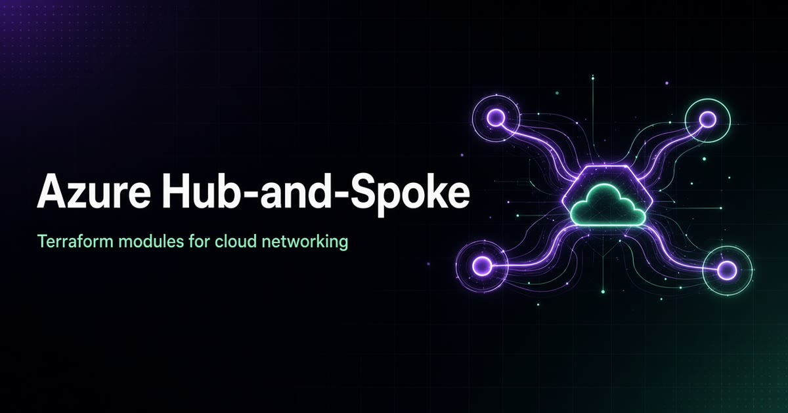
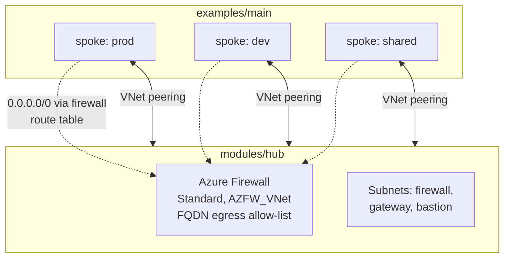

# Azure Hub-and-Spoke Terraform (starter)



Starter Terraform modules for a basic Azure **hub-and-spoke** network layout, plus a small example wiring them together.

This is a **learning / foundation** repo — not a full enterprise landing zone.

## What's in the repo

```
modules/hub/      # hub VNet-oriented module
modules/spoke/    # spoke VNet-oriented module
examples/main/    # example that wires hub + spoke
```

## What this is not

The earlier marketing README over-claimed. This repository does **not** currently include:

- 50+ Azure Policy assignments
- Multi-region production topology with published uptime targets
- Private endpoint packs, GitLab CI, or OPA gates as maintained code in-tree

If you need those, add them deliberately — don't invent metrics.

## Design & Engineering

I designed this as a clean foundation for Azure networking: a hub that owns shared egress and security, and spokes that only own their workloads.

**Design goals**

- Keep hub and spoke as separate, reusable modules.
- Force all spoke internet traffic through one central firewall.
- Stay small and honest: a starter to extend, not a full landing zone.

**Architecture**



**Key design decisions and trade-offs**

| Decision | Why | Trade-off |
|---|---|---|
| Separate hub and spoke modules | Each spoke is one module call; teams can add spokes without touching the hub | Peering lives in the root example, so each new spoke needs two peering resources |
| Default route to the firewall in every spoke | One place to control and log egress | The firewall is a cost and a single choke point |
| FQDN allow-list for egress (AzureCloud tag, Ubuntu NTP) | Deny by default, allow what's needed | The list has to be maintained per workload |
| Example wires 3 spokes (prod, dev, shared) | Shows the pattern end to end | Naming and CIDRs are examples to replace |

**Engineering details**

- **Stack:** Terraform with the `azurerm` provider; `modules/hub`, `modules/spoke`, `examples/main`.
- **Hub:** resource group, VNet, firewall / gateway / bastion subnets, firewall public IP, firewall and an application rule collection.
- **Spoke:** resource group, VNet, workload subnets, route table with a default route to the hub firewall's private IP, subnet associations.
- **Testing:** no CI yet; run `terraform fmt` and `terraform validate` locally (see Known limitations).

**What I'd do next**

- A `terraform validate` / `fmt` / plan workflow in CI.
- Move peering into the spoke module so adding a spoke is one block.
- Private DNS zones and private endpoint patterns, added deliberately and documented.

## Usage

```bash
cd examples/main
terraform init
terraform plan
```

Review `modules/hub` and `modules/spoke` before applying. Treat this as a template to extend for your subscription, naming, and security standards.

## Known limitations

- Keep Azure Firewall SKU / hub vs VNet Firewall subnet choices aligned with current `azurerm` provider docs before apply — older samples sometimes mix hub firewall SKUs with classic `AzureFirewallSubnet` layouts.
- No automated `terraform validate` CI is attached yet; run `terraform fmt` / `terraform validate` locally.

## License

Use at your own risk in non-production first. No warranty.
